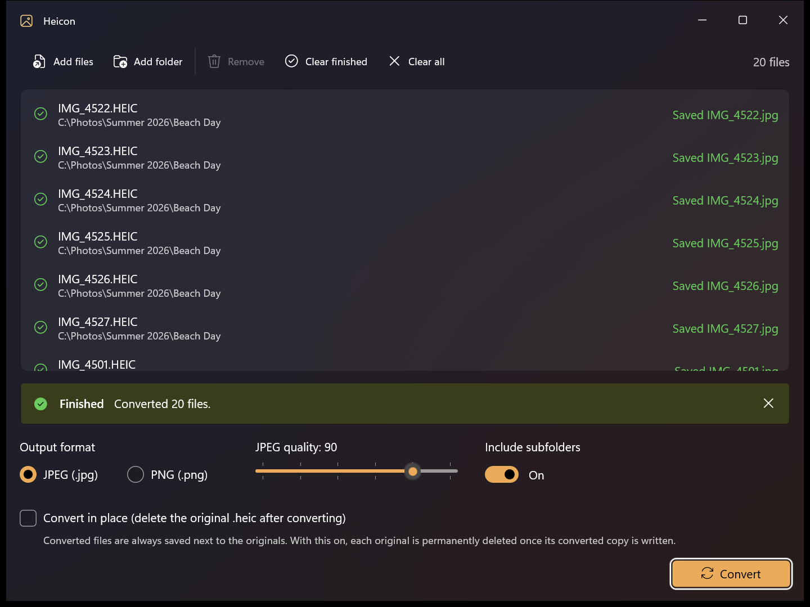

# Heicon

Heicon is a small Windows app for batch-converting HEIC/HEIF photos, the format iPhones use by default, into JPEG or PNG. Point it at a few files or an entire photo library, press **Convert**, and the converted images are written right next to the originals.



## Features

- **Add photos three ways.** Drag and drop files or folders from Explorer, or use the **Add files** and **Add folder** buttons. Only `.heic` and `.heif` files are picked up; everything else in a folder is ignored, and files already in the list aren't added twice.
- **Whole directories.** With **Include subfolders** on, adding a folder also searches every folder beneath it.
- **JPEG or PNG output.** JPEG quality can be set from 50 to 100 (default 90).
- **Convert in place.** Optionally delete each original `.heic` once its converted copy has been written and checked. Heicon asks for confirmation before it starts, and an original is never deleted if its conversion failed or was skipped.
- **Safe by default.** If the output file already exists (for example `IMG_4501.jpg`), that photo is skipped rather than overwritten. Converted files are written to a temporary file first, so a failed conversion never leaves a half-written image behind.
- **Keeps your photo details.** Photos are rotated to display upright, EXIF metadata and color profiles are preserved, and the converted file keeps the original's created/modified dates.
- **Fast.** Several photos are converted at once, with per-file status, an overall progress bar, and a Cancel button.

## Using Heicon

1. Add photos by dropping them onto the window or using **Add files** / **Add folder**.
2. Choose **JPEG** or **PNG**, and adjust the JPEG quality if needed.
3. Tick **Convert in place** if you want the original HEIC files removed after conversion.
4. Click **Convert**.

Each file shows its result: a green check for converted, a yellow warning for skipped, and a red mark for failed (hover over a message to see the full text). Pressing **Convert** again retries only the files that haven't been converted yet. **Clear finished** removes completed files from the list, and **Delete** removes the selected ones.

> **Note:** In-place deletion is permanent; originals don't go to the Recycle Bin.

## Requirements

- Windows 10 version 1809 or later, or Windows 11 (x64, x86, or ARM64)
- No extra codecs needed. Heicon bundles its own HEIC decoder ([Magick.NET](https://github.com/dlemstra/Magick.NET), built on ImageMagick and libheif), so the Microsoft Store *HEIF/HEVC Image Extensions* aren't required.

## Building from source

### Prerequisites

- [Visual Studio 2026](https://visualstudio.microsoft.com/) (or Visual Studio 2022 17.13+, which can open `.slnx` solutions) with the **WinUI application development** workload, **or** just the command line tools below
- [.NET 8 SDK](https://dotnet.microsoft.com/download/dotnet/8.0) or later

NuGet restores the remaining dependencies (Windows App SDK, Magick.NET) automatically.

### Visual Studio

1. Open `heicon.slnx`.
2. Select a platform (`x64`, `x86`, or `ARM64`) and the **heicon (Unpackaged)** launch profile.
3. Press **F5** to build and run.

To produce a distributable build, right-click the project and choose **Publish**, then pick one of the included profiles (`win-x64`, `win-x86`, `win-arm64`).

### Command line

Build and run a debug build:

```powershell
dotnet build heicon.csproj -p:Platform=x64
.\bin\x64\Debug\net8.0-windows10.0.19041.0\win-x64\heicon.exe
```

Publish a release build:

```powershell
dotnet publish heicon.csproj -c Release -p:Platform=x64 -p:PublishProfile=win-x64.pubxml
```

The output is a single `heicon.exe` in `bin\Release\net8.0-windows10.0.19041.0\win-x64\publish\`. Use `x86` / `win-x86` or `ARM64` / `win-arm64` for the other architectures.

### Distributing

Heicon publishes as a **single, self-contained `heicon.exe`**: the .NET runtime, the Windows App SDK, and the HEIC decoder are all bundled inside it, so it runs on any supported PC without installing anything. To distribute it, just copy the exe.

On its first launch, the exe unpacks its bundled files to `%TEMP%\.net\heicon\` (about 150 MB), which takes a few seconds; later launches reuse them and start quickly. To unpack somewhere else, set the `DOTNET_BUNDLE_EXTRACT_BASE_DIR` environment variable.

Release builds are trimmed to reduce their size. If you switch between Debug and Release builds or change packaging settings and the app fails to start, run **Build → Clean Solution** (or delete the `bin` and `obj` folders) and build again.

## Project layout

| Path | Purpose |
|---|---|
| `MainWindow.xaml`, `MainWindow.xaml.cs` | The UI: file list, drag and drop, pickers, options, and the conversion run |
| `Services/HeicConverter.cs` | Converts a single file and handles skip-if-exists, temp-file writes, and in-place deletion |
| `Services/FileCollector.cs` | Expands dropped/picked files and folders into the list of HEIC/HEIF files |
| `Models/` | The per-file list item and its status |
| `Properties/PublishProfiles/` | Publish profiles for x64, x86, and ARM64 |

## License

Heicon is released under the [MIT License](LICENSE).
